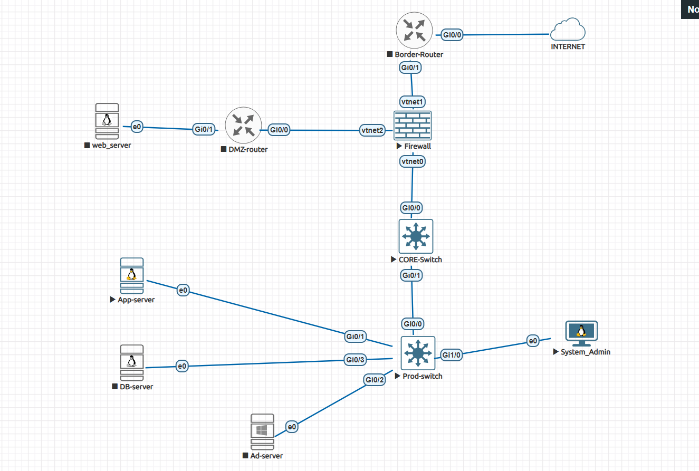

# Ansible Infrastructure Hardening

An Ansible-based automation project for **auditing and hardening** a multi-tier infrastructure including web servers, application servers, databases, Active Directory, firewalls (OPNsense), and SSH configurations.

---

## Target Infrastructure Architecture ( Eve-ng simulation )



> Multi-tier network: DMZ (web server via DMZ-router), internal production zone (App, DB, AD servers) through Core and Prod switches, OPNsense Firewall between internet and internal segments, managed by a Centralized System Admin workstation via Ansible.

---

## Project Structure


```
ansible-infrastructure-hardening/
├── inventory/
│   ├── hosts.ini.example     # Template inventory (copy and fill in your values)
│   └── hosts.ini             # Your real inventory (git-ignored, never committed)
├── group_vars/               # Group-level variables
├── host_vars/                # Host-level variables
├── playbooks/
│   ├── ssh_audit.yml
│   ├── ss_hardening.yml
│   ├── system_audit.yml
│   ├── system_hardening.yml
│   ├── web_audit.yml
│   ├── web_hardening.yml
│   ├── app_audit.yml
│   ├── app_hardening.yml
│   ├── db_audit.yml
│   ├── db_hardening.yml
│   ├── ad_audit.yml
│   ├── ad_hardening.yml
│   ├── opnsense_audit.yml
│   └── opnsense_hardening.yml
├── roles/
│   ├── ssh_audit/
│   ├── ssh_hardening/
│   ├── system_baseline/
│   ├── system_web/
│   ├── system_app/
│   ├── system_db/
│   ├── system_ad/
│   └── system_opnsense/
└── reports/                  # Generated audit reports (git-ignored)
```

---

## Scope

| Target           | Audit | Hardening |
|------------------|:-----:|:---------:|
| SSH              | ✅    | ✅        |
| Linux Baseline   | ✅    | ✅        |
| Web Server       | ✅    | ✅        |
| App Server       | ✅    | ✅        |
| Database Server  | ✅    | ✅        |
| Active Directory | ✅    | ✅        |
| Firewall         | ✅    | ✅        |

---

## Requirements

- **Ansible** >= 2.12
- **Python** >= 3.8
- **pywinrm** (for Windows/AD targets): `pip install pywinrm`
- SSH access to Linux hosts
- WinRM enabled on Windows/AD hosts

---

## Usage

### Run an audit

```bash
# SSH audit
ansible-playbook -i inventory/hosts.ini playbooks/ssh_audit.yml

# Full system audit
ansible-playbook -i inventory/hosts.ini playbooks/system_audit.yml

# Web server audit
ansible-playbook -i inventory/hosts.ini playbooks/web_audit.yml

# Database audit
ansible-playbook -i inventory/hosts.ini playbooks/db_audit.yml

# Active Directory audit
ansible-playbook -i inventory/hosts.ini playbooks/ad_audit.yml

# OPNsense firewall audit
ansible-playbook -i inventory/hosts.ini playbooks/opnsense_audit.yml
```

### Run hardening

```bash
# SSH hardening
ansible-playbook -i inventory/hosts.ini playbooks/ss_hardening.yml

# System baseline hardening
ansible-playbook -i inventory/hosts.ini playbooks/system_hardening.yml

# Web server hardening
ansible-playbook -i inventory/hosts.ini playbooks/web_hardening.yml

# Database hardening
ansible-playbook -i inventory/hosts.ini playbooks/db_hardening.yml

# Active Directory hardening
ansible-playbook -i inventory/hosts.ini playbooks/ad_hardening.yml

# OPNsense firewall hardening
ansible-playbook -i inventory/hosts.ini playbooks/opnsense_hardening.yml
```

---

## License

This project is for educational and internal use. Adapt freely.
